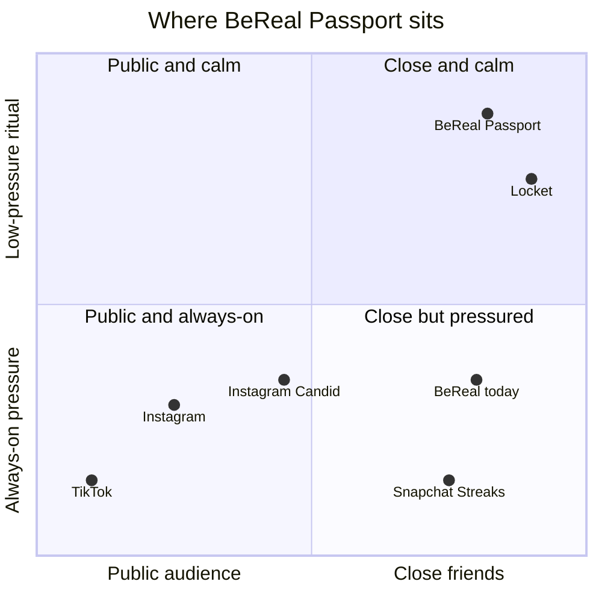

# BeReal Passport & Community Boards — Competitive Analysis

**[Feature Working Session](https://github.com/LashawnFofung/BeReal-RealProcess/blob/main/Feature%20Working%20Session/Feature%20Working%20Session.md)** · **[Test Plan](https://github.com/LashawnFofung/BeReal-RealProcess/blob/main/Test%20Plan/Test%20Plan.md)** · **[PRD v2.0](https://github.com/LashawnFofung/BeReal-RealProcess/blob/main/PRD/PRD.md)** · **[Back to README](https://github.com/LashawnFofung/BeReal-RealProcess#readme)**

> *Independent concept created for a UI/UX Design & Product Management Externship. Not affiliated with or endorsed by BeReal.*

---

## Summary

Every major social app competes for the same daily habit, but they win it in different ways. **TikTok** wins with an endless algorithmic feed. **Instagram** wins with scale and copies new formats quickly. **Snapchat** wins with streaks that people are afraid to lose. **Locket** wins with quiet, close-friends presence on the home screen.

BeReal's position is distinct: **real photos, real friends, no performance**. Its weakness is that it offers one reason to open the app per day, and that reason can feel like pressure.

**BeReal Passport & Community Boards** adds a second reason to come back, collecting and sharing with your squad, *without* adopting the pressure mechanics BeReal was built against. The feature itself can be copied. What's hard to copy is that it only makes sense on a platform built around authenticity, small groups, and no public likes.

 

## Market context

| Fact | Detail | Source |
| --- | --- | --- |
| BeReal's 2022 peak | 73.5M monthly active users in August 2022, up from 21.6M in July | [Wikipedia](https://en.wikipedia.org/wiki/BeReal) |
| BeReal's decline | Daily users fell about 61%, from roughly 15M (October 2022) to under 6M (March 2023), per Apptopia | [Platformer, citing The New York Times](https://platformer.news/how-bereal-missed-its-moment) |
| Fast copying by competitors | Instagram added Dual Camera (July 2022) and Candid Stories (announced December 2022); TikTok launched TikTok Now (September 2022) | [Engadget](https://www.engadget.com/instagram-bereal-candid-notes-172854546.html), [Wikipedia](https://en.wikipedia.org/wiki/BeReal) |
| Acquisition | Voodoo acquired BeReal in June 2024 for a reported €500M, citing about 40M active users, about half of them on 6+ days a week | [Konvoy](https://www.konvoy.vc/content/voodoo-gets-real) |
| Close-friends apps growing | Locket has 91M+ lifetime installs and 100K+ subscribers; its weekly "Rollcall" recap is posted by over 25% of active users | [TechCrunch, Nov 2025](https://techcrunch.com/2025/11/03/lockets-social-app-is-picking-up-steam-with-gen-alpha/) |
| TikTok time spent | About 95 minutes per user per day (third-party estimate, undated) | [Omnicore, via NGPF](https://www.ngpf.org/blog/question-of-the-day/question-of-the-day-how-long-does-the-average-user-spend-on-tiktok-a-day) |

**Data note:** a widely repeated claim that BeReal has "72% daily engagement among active users" traces back to aggregator sites with no date or original source, and it conflicts with other published figures. I left it out. When the numbers disagree, the analysis relies on dated, attributed sources.

 

## Competitive landscape

| | **TikTok** | **Instagram** | **Snapchat** | **Locket** | **BeReal today** | **BeReal + Passport** |
| --- | --- | --- | --- | --- | --- | --- |
| **Core loop** | Endless algorithmic video feed | Feed, Stories and Reels from people you follow | Messaging with friends | Friends' photos appear on your home-screen widget | One timed, dual-camera photo a day | The daily BeReal, plus optional themed squad boards |
| **Audience** | Public, strangers | Mostly public, with Close Friends lists | Friends | Close friends | Friends | Small squads |
| **Main retention hook** | Variable reward: what's next? | Social validation (likes, views) | Streaks: don't break the chain | Ambient presence | The random daily alert | Collection: stamps, capsules and the monthly board |
| **Pressure level** | High (time sink) | High (performance) | High (loss-framed streaks) | Low | Medium (2-minute timer) | **Low** (no timer, no public likes, no streak to lose) |
| **Gap it leaves** | Not about your friends | Curated, not real | Pressure and obligation | Little shared occasion or progression | One reason to open per day | — |

### Positioning map

The **close-and-calm** quadrant is the least crowded. Locket owns quiet presence there, but it offers no shared occasion and no progression. BeReal Passport moves BeReal into that space by adding monthly themes and collecting, which Locket lacks.

 

## Feature benchmarks: what drives retention today

From my research into how the two most relevant apps keep users coming back:

**TikTok**

| Feature | What it is | How it drives retention |
| --- | --- | --- |
| For You Page | An algorithm-driven, endless feed based on watch time and behavior, not just who you follow | A variable reward loop: users never know what's next, so they keep scrolling |
| Duets and Stitch | Tools to remix, respond to or build on someone else's video | Turns watching into participating; people return to check responses and join trends |
| Hashtag challenges and streaks | Viral challenges, plus streak tracking and flame badges | A gamified layer of progression and social reward for showing up regularly |

**BeReal**

| Feature | What it is | How it drives retention |
| --- | --- | --- |
| Daily random notification | One alert at a random time, with a 2-minute window to post a dual-camera photo | A daily check-in built on unpredictability; keeps the app top of mind |
| Locked feed (no peeking) | Friends' posts stay hidden until you post | Reciprocity: you have to post before you can browse |
| RealMoji reactions | Reactions made from a photo of your own face | A two-way interaction that pulls people back to see responses |

**Takeaway:** TikTok keeps people engaged through discovery and gamification, without needing a friend network. BeReal's loop is built on friends and reciprocity, but it gives users only **one reason a day** to open the app. The working session shows how I turned these mechanics into features → [Feature Working Session](https://github.com/LashawnFofung/BeReal-RealProcess/blob/main/Feature%20Working%20Session/Feature%20Working%20Session.md)

 

## Why build this in BeReal, not Instagram or Locket?

| Interviewer question | Answer |
| --- | --- |
| **Why not just use Instagram?** | Instagram's business runs on public reach, likes and ads, which is the performance culture BeReal users are avoiding. Its BeReal copy (Candid Stories) borrowed the *format* but not the *trust*. |
| **Why not Locket?** | Locket is close-friends and calm, but it's ambient. It has no shared occasion, no theme to rally around, and no collection that builds over time. |
| **Why not Snapchat Streaks?** | Streaks work through fear of loss. BeReal Passport rewards showing up ("You've been real 3 days in a row — no streak to lose") without punishing a missed day. |
| **Why BeReal?** | BeReal already has the hardest parts: an authentic dual-camera format, a friend graph, and a brand people trust to be real. Passport adds the missing **second reason to open the app**. |

 

## What stops a competitor from copying this?

**Honestly, the feature can be copied.** Instagram shipped BeReal's camera format within months. Defensibility doesn't come from the feature; it comes from four things around it:

| Moat | Why it's hard to copy |
| --- | --- |
| **1. Brand fit** | Squad-only reactions, no public likes and opt-in only conflict with an engagement- and ads-driven model. A competitor *can* build it, but it undercuts their core business. |
| **2. Switching costs that grow** | Every month adds stamps to your Passport and a capsule to your Memories. Your collection lives in BeReal and can't move to another app. |
| **3. Small-group network effects** | A board is only fun if *your squad* is on it. Once a squad's monthly ritual lives in BeReal, moving it takes everyone switching together. |
| **4. Operating cadence** | New themed and sponsored stamps every month is an ongoing content operation, not a one-time feature. Speed and taste compound over time. |

**Risk response:** ship fast, keep the monthly cadence, and build sponsor partnerships that fit BeReal's brand, so that by the time a copy appears, squads already have months of collections.

 

## Borrow, adapt, avoid

| Mechanic | Seen in | Decision | How it shows up in BeReal Passport |
| --- | --- | --- | --- |
| Themed challenges | TikTok | **Adapt** | Monthly themed boards (HIKE, CRAMMING, COFFEE, HAUNTED) |
| Progression badges | TikTok, Snapchat | **Adapt** | Collectible Real Passport stamps, with no loss framing |
| Streaks | Snapchat, TikTok | **Soften** | "You've been real 3 days in a row" — no streak to lose |
| Reciprocity (post to see) | BeReal | **Keep** | Friends' posts stay blurred until you post |
| Face-based reactions | BeReal (RealMoji) | **Keep and focus** | Squad-only reactions, no public like counts |
| Close-friends intimacy | Locket | **Adopt** | Small squads instead of a wide friend list |
| Weekly recap ritual | Locket (Rollcall) | **Adapt** | Monthly capsule saved to Memories |
| Endless algorithmic feed | TikTok, Instagram | **Avoid** | Boards are time-boxed and close each month |
| Public likes and follower counts | Instagram, TikTok | **Avoid** | No public metrics anywhere |

 

## Sources

- [BeReal — Wikipedia](https://en.wikipedia.org/wiki/BeReal)
- [How BeReal missed its moment — Platformer (Apr 2023), citing The New York Times and Apptopia](https://platformer.news/how-bereal-missed-its-moment)
- [Instagram launches its BeReal clone, Candid Stories — Engadget (Dec 2022)](https://www.engadget.com/instagram-bereal-candid-notes-172854546.html)
- [Voodoo gets real — Konvoy (Jun 2024)](https://www.konvoy.vc/content/voodoo-gets-real)
- [Locket's social app is picking up steam with Gen Alpha — TechCrunch (Nov 2025)](https://techcrunch.com/2025/11/03/lockets-social-app-is-picking-up-steam-with-gen-alpha/)
- [How long does the average user spend on TikTok a day? — NGPF, citing Omnicore](https://www.ngpf.org/blog/question-of-the-day/question-of-the-day-how-long-does-the-average-user-spend-on-tiktok-a-day)

---

Built by **Lashawn Fofung**, MBA, PMP, CSM, CSPO.
