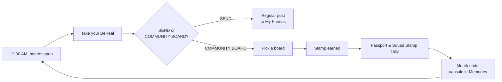

# Feature Working Session: From Competitor Mechanics to BeReal Passport

**[Competitive Analysis](https://github.com/LashawnFofung/BeReal-RealProcess/blob/main/Competitive%20Analysis/Competitive%20Analysis.md)** · **[Test Plan](https://github.com/LashawnFofung/BeReal-RealProcess/blob/main/Test%20Plan/Test%20Plan.md)** · **[PRD v2.0](https://github.com/LashawnFofung/BeReal-RealProcess/blob/main/PRD/PRD.md)** · **[Back to README](https://github.com/LashawnFofung/BeReal-RealProcess#readme)**

> *Independent concept created for a UI/UX Design & Product Management Externship. Not affiliated with or endorsed by BeReal.*

---

This page walks through how I went from competitor research to the features in BeReal Passport & Community Boards: what I looked at, what I kept, what I rejected, and why. It's structured as a working session, so the reasoning behind each decision is visible.

 

## 1. Frame the problem

**Starting point:** BeReal's daily users fell about 61% from their late-2022 peak. My persona, **Denise**, is an introverted first-time user who feels put on the spot by the 2-minute timer and shut out by the locked feed.

**How might we** give casual users a second reason to open BeReal, **without** adding pressure or breaking what makes it real?

**Guardrails I set before brainstorming.** Any idea had to pass all four:

| Guardrail | Test |
| --- | --- |
| **Authentic** | Same real, unfiltered photo; no new content requirement |
| **Opt-in** | Nothing changes for people who ignore it |
| **Low pressure** | No timers, no loss framing, no shame |
| **Friends-only** | No public metrics, no strangers |

 

## 2. Benchmark what drives retention

I studied the features that keep TikTok and BeReal users coming back ([full tables](https://github.com/LashawnFofung/BeReal-RealProcess/blob/main/Competitive%20Analysis/Competitive%20Analysis.md#feature-benchmarks-what-drives-retention-today)), then looked at Snapchat, Instagram and Locket for comparison.

| App | Feature | The underlying mechanic |
| --- | --- | --- |
| TikTok | For You Page | **Variable reward**: you never know what's next |
| TikTok | Duets and Stitch | **Participation**: build on what others made |
| TikTok | Hashtag challenges and streaks | **Shared occasion** plus **progression** |
| BeReal | Daily random notification | **A daily trigger** |
| BeReal | Locked feed | **Reciprocity**: give to get |
| BeReal | RealMoji | **Two-way social response** |
| Snapchat | Streaks | **Loss aversion**: don't break the chain |
| Instagram | Candid Stories | **Format copying**: same camera, different trust |
| Locket | Home-screen widget and Rollcall | **Ambient presence** plus a **weekly recap ritual** |

**Insight:** the features differ, but the mechanics underneath are few: triggers, reciprocity, shared occasions, progression and social response. BeReal already has a trigger and reciprocity. **It's missing a shared occasion and progression.**

 

## 3. Run each mechanic through the guardrails

| Mechanic | Authentic | Opt-in | Low pressure | Friends-only | Decision |
| --- | --- | --- | --- | --- | --- |
| Variable reward (endless feed) | ✅ | ❌ | ❌ | ❌ | **Reject** |
| Participation (remixing) | ❌ edits the photo | ✅ | ✅ | ❌ public | **Reject the remix, keep the idea of participating** |
| Shared occasion (challenges) | ✅ | ✅ | ✅ if untimed | ✅ if squad-only | **Adapt → monthly themed boards** |
| Progression (badges) | ✅ | ✅ | ✅ if no loss | ✅ | **Adapt → collectible stamps** |
| Loss aversion (streaks) | ✅ | ❌ feels forced | ❌ | ✅ | **Soften → streak cue with nothing to lose** |
| Reciprocity (locked feed) | ✅ | ✅ | ⚠️ | ✅ | **Keep** |
| Social response (reactions) | ✅ | ✅ | ✅ if private | ✅ | **Keep → squad-only, no public likes** |
| Recap ritual | ✅ | ✅ | ✅ | ✅ | **Adapt → monthly capsule** |
| Ambient presence (widget) | ✅ | ✅ | ✅ | ✅ | **Park for later**: good fit, not core to the loop |

 

## 4. Turn the survivors into features

| Mechanic kept | Feature | Prototype detail |
| --- | --- | --- |
| Shared occasion | **Community Boards** | October boards: HIKE, CRAMMING, COFFEE and HAUNTED, plus sponsored LITTLE WINS and GAME TIME |
| Progression | **Real Passport stamps** | One stamp per board post; the October stamp gallery shows earned stamps as Unlocked |
| Social response | **Squad-only reactions** | Emoji reactions inside the squad, with no public like counts |
| Recap ritual | **Monthly capsule** | Each month's board saved to Memories as a carousel or collage |
| Soft trigger | **Reminder hooks** | "3 friends already posted to CRAMMING today" · "You've been real 3 days in a row" · "Come back tomorrow for a new BeReal Passport" |
| Opt-in | **Settings & Opt-out** | Per-board ON/OFF switches under Settings → Features |

 

## 5. Design the loop

**Key design decision: the photo comes first, the board comes second.** Taking a BeReal stays exactly as fast as today; the board choice is a layer on top. Testers later noticed the extra taps this adds, which became the top fix in the [Test Plan](https://github.com/LashawnFofung/BeReal-RealProcess/blob/main/Test%20Plan/Test%20Plan.md).

 

## 6. Decide what's in the MVP

| Priority | Features |
| --- | --- |
| **Must have** | Community Boards; SEND / COMMUNITY BOARD choice; Real Passport stamps; Passport tab; per-board opt-in and opt-out |
| **Should have** | Squad Stamp Tally; reminder hooks; monthly capsule |
| **Could have** | Sponsored boards and stamps; shorter day- or week-long boards |
| **Won't have (for now)** | Comments; public leaderboard; home-screen widget; any streak that can be lost |

 

## 7. Name the riskiest assumptions

| Assumption | If it's wrong | How I'll test it |
| --- | --- | --- |
| A shared theme gives casual users a reason to return | No lift in active days | A/B experiment, primary metric ([Test Plan](https://github.com/LashawnFofung/BeReal-RealProcess/blob/main/Test%20Plan/Test%20Plan.md)) |
| Stamps motivate without feeling like pressure | Opt-outs rise, or the feature feels "not BeReal" | "Low-pressure" score; board opt-out guardrail |
| Boards add to regular posting rather than replace it | Regular posts drop | Guardrail: SEND posts must not drop more than 2% |
| Enough of a squad joins for a board to feel alive | Empty boards, low engagement | Board opt-in rate; empty-state frequency |
| The extra step after capture is acceptable | Users abandon the flow | Taps and time from shutter to stamped post |

 

## 8. What testing changed

The [5-person focus group](https://github.com/LashawnFofung/BeReal-RealProcess#testing--results) validated the direction: **4 of 5** said they'd open BeReal more often, and reminders scored **4.2/5** for feeling low-pressure. It also showed that the risk wasn't pressure; it was **complexity**. That finding moved the plan from "build the MVP" to "**refine, then retest**" ([PRD v2.0](https://github.com/LashawnFofung/BeReal-RealProcess/blob/main/PRD/PRD.md)).

 

## What I'd tell an interviewer

- I didn't copy features; I copied **mechanics**, and only the ones that passed BeReal's values.
- The most important decisions were **what I rejected**: the endless feed, public likes and loss-framed streaks.
- The feature can be copied, but the brand fit, growing collections and squad rituals around it are much harder to copy ([Competitive Analysis](https://github.com/LashawnFofung/BeReal-RealProcess/blob/main/Competitive%20Analysis/Competitive%20Analysis.md#what-stops-a-competitor-from-copying-this)).

---

Built by **Lashawn Fofung**, MBA, PMP, CSM, CSPO.
