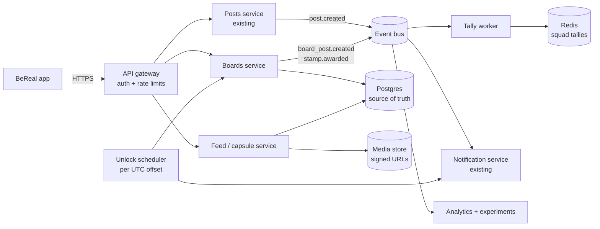
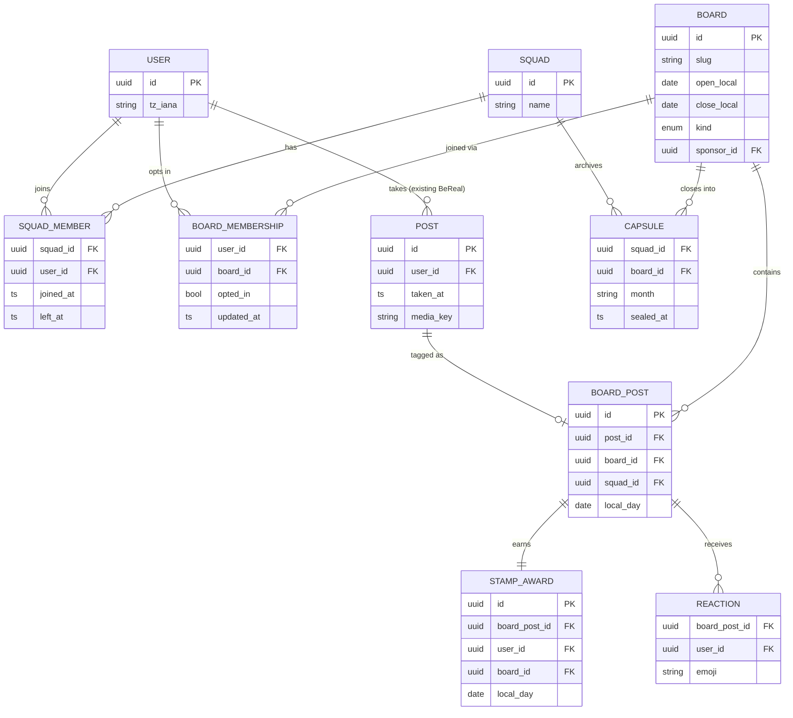

# BeReal Passport & Community Boards — Technical Design

**[PRD v2.0](https://github.com/LashawnFofung/BeReal-RealProcess/blob/main/PRD/PRD.md)** · **[Test Plan](https://github.com/LashawnFofung/BeReal-RealProcess/blob/main/Test%20Plan/Test%20Plan.md)** · **[Live prototype](https://lashawnfofung.github.io/BeReal-RealProcess/)** · **[Back to README](https://github.com/LashawnFofung/BeReal-RealProcess#readme)**

> *Independent concept created for a UI/UX Design & Product Management Externship. Not affiliated with or endorsed by BeReal.*

---

## Summary

This page proposes how BeReal Passport & Community Boards could be built **on top of BeReal's existing systems**, adding as little as possible. The core idea: **a board post is a tag on an existing BeReal post, not a new kind of content.** The photo, camera, upload and moderation all stay as they are. The feature adds four things:

1. **Data model:** squads, boards, board memberships, board posts and stamps
2. **Scheduling:** boards unlock at 12:00 AM *local* time for every user
3. **Squad Stamp Tally:** a squad leaderboard that's fast to read and always correct
4. **Privacy:** squad-only visibility, enforced on the server

*BeReal's real architecture isn't public. Services marked "existing" are assumed, and the numbers here are planning assumptions.*

 

## Architecture

| Component | New or existing | Responsibility |
| --- | --- | --- |
| **Boards service** | New | Boards, opt-in and opt-out, tagging posts to boards, awarding stamps |
| **Unlock scheduler** | New | Opens boards and sends the 12:00 AM alert per timezone |
| **Tally worker** | New | Keeps each squad's Stamp Tally up to date |
| **Feed / capsule service** | New | Board feeds, the Passport, monthly capsules; enforces squad-only access |
| Posts, notifications, media, moderation | Existing | Unchanged; boards reuse them |

 

## 1. Data model

**Key decisions:**

| Decision | Why |
| --- | --- |
| **`BOARD_POST` points to an existing `POST`** rather than copying it | The photo stays identical to a regular BeReal (the PRD's authenticity guardrail), and deleting the post removes it from the board automatically |
| **Boards store local *dates* (`open_local`, `close_local`), not timestamps** | "October 1" means midnight in *each user's* timezone, not one global moment (see section 2) |
| **`BOARD_MEMBERSHIP` is per user, per board** | Supports opting in or out board by board, as in Settings → Opt-in / Opt-out - Community Board |
| **`BOARD_POST` records the `squad_id`** | Every read can be checked against squad membership cheaply (see section 4) |
| **Unique constraint on `STAMP_AWARD (user_id, local_day)`** | **One stamp per user per day**, matching BeReal's one-photo-a-day rhythm and preventing stamp farming |
| **Sponsored boards are boards with a `sponsor_id`** | No separate system; stamp art and taglines are configuration, not code |

**Key API endpoints:**

| Endpoint | Purpose |
| --- | --- |
| `GET /boards/today` | Live boards for the user's local date, with lock state and squad post counts |
| `PUT /boards/{id}/membership` | Opt in or out of a board |
| `POST /posts/{id}/board` | Tag today's post to a board and award the stamp. Requires an **idempotency key**, so a retry after "That didn't go through" never double-stamps |
| `GET /passport` · `GET /squads/{id}/tally` | Stamp gallery and Squad Stamp Tally |
| `GET /boards/{id}/feed` · `GET /capsules/{id}` | Squad-only board feed and monthly capsule |

 

## 2. Scheduling the 12:00 AM unlock

**The problem:** boards open at **12:00 AM in each user's own timezone**. One global unlock would open boards at 3 PM for some users and 4 AM for others.

**The approach: unlock by UTC offset, not by user.**

1. **Each user has a timezone** (`tz_iana`, e.g. `America/New_York`), taken from the device.
2. **Users are grouped by their current UTC offset.** There are fewer than 40 offsets worldwide, including half-hour and 45-minute ones, so the scheduler has fewer than 40 jobs a night, not millions.
3. **The scheduler fires at each offset's midnight** and does two things:
   - marks the day's boards as open for that offset group
   - queues the 12:00 AM alert ("12:00 AM Community Board open!!") through the existing notification service, sent in batches
4. **Reads don't depend on the job.** `GET /boards/today` computes lock state from the server's clock and the user's timezone, so boards still show correctly if a job runs late; the job only triggers the alert.

**Edge cases:**

| Case | Handling |
| --- | --- |
| **Daylight saving time** | Offsets are recalculated from `tz_iana` each day, so users move between offset groups automatically |
| **Travel or timezone changes** | The new timezone applies from the *next* local day. This stops users from changing timezones to get extra days or stamps. |
| **Month end** | The board closes at the end of `close_local` in each timezone; the **capsule is sealed** once the last timezone (UTC−12) has passed midnight |
| **Retries** | Unlock and notification jobs are **idempotent** (keyed by offset and date), so a retry never sends a second alert |
| **Notification fatigue** | One alert per day maximum; it respects the user's notification settings (PRD requirement 7.1) |

 

## 3. Computing the Squad Stamp Tally

**The problem:** the tally ("Alex M. — 14 stamps") is read every time someone opens the Passport, but changes only when a stamp is earned. Counting every stamp on every read doesn't scale.

**The approach: write-time counters, plus nightly reconciliation.**

| Step | How |
| --- | --- |
| **1. Award** | Tagging a post to a board writes `BOARD_POST` and `STAMP_AWARD` in **one database transaction**, then publishes `stamp.awarded` |
| **2. Increment** | The tally worker reads the event and increments a **Redis sorted set** per squad per month (`tally:{squad_id}:{yyyy-mm}`), with one score per member |
| **3. Read** | `GET /squads/{id}/tally` reads the sorted set: one fast lookup, already ranked |
| **4. Reconcile** | A **nightly job** recounts from Postgres, the source of truth, and repairs any drift from missed or duplicate events. This is the "refreshes nightly" requirement in PRD 7.5. |

**Tally rules:**
- Only stamps earned **while in the squad** count; leaving the squad removes the member from that squad's tally.
- Ties rank by who reached the count first, so there are no shared ranks to explain.
- The tally **resets each month** with the boards, consistent with "no streak to lose."
- **No public or cross-squad leaderboard exists anywhere** (a PRD non-goal).

 

## 4. Enforcing squad-only privacy

**The principle:** privacy is enforced **on the server, on every read**. Hiding content in the app's interface isn't enough, because anyone calling the API directly would see everything.

| Rule | Enforcement |
| --- | --- |
| **Only squad members see a board post** | Every feed, capsule and reaction query filters on the viewer being a current `SQUAD_MEMBER` of the post's `squad_id`. This happens in the data-access layer, so no endpoint can skip it. |
| **Only opted-in members see a board** | The viewer must also have an active `BOARD_MEMBERSHIP` for that board |
| **Post to see (locked feed)** | Squad posts for today stay blurred until the viewer has posted today. The server returns blurred placeholders, not the real images. |
| **Photos can't be shared outside the app** | Media is served through **short-lived signed URLs** issued only after the checks above; a copied link stops working within minutes |
| **Leaving a squad, or opting out of a board** | Access ends immediately; the member's tally score is removed |
| **Deleting a post** | The `BOARD_POST`, its reactions and its capsule entry are removed with it |
| **Blocking** | Blocked users never see each other's board posts, even in the same squad |
| **Sponsors** | Sponsors get **aggregate counts only** (posts and opt-ins per board), never photos, names or per-user data, and only when a board has 50+ participants, so no individual can be identified |
| **No public metrics** | Reactions are visible only inside the squad; no API returns public like counts |

**How we'd verify it:** automated tests that call every board endpoint as a non-member and expect `403 Forbidden`, plus a privacy review before Phase 2 launch.

 

## Rollout and reliability

| Concern | Approach |
| --- | --- |
| **Feature flag and kill switch** | Boards sit behind a server-side flag; turning it off hides boards without touching regular posting |
| **Experiment assignment** | Assignment is keyed by **`squad_id`**, matching the squad-level randomization in the [Test Plan](https://github.com/LashawnFofung/BeReal-RealProcess/blob/main/Test%20Plan/Test%20Plan.md) |
| **Analytics events** | Emitted from the event bus (`board_optin`, `post_type_selected`, `stamp_post_success`, and others), as listed in the Test Plan |
| **Failure isolation** | If the Boards service fails, regular BeReal posting is unaffected; the app falls back to SEND |
| **Performance targets** | Tag-and-stamp under 300 ms at p95; Tally read under 50 ms at p95 *(planning targets)* |

 

## Open questions

- **Timezone source:** device setting only, or confirmed against location?
- **Squads and friend lists:** is a squad a subset of a user's friends, or a separate group with invitations?
- **Reaction storage:** reuse RealMoji infrastructure, or keep board reactions separate?
- **Capsule retention:** how long are sealed capsules kept, and can users export them?

---

Built by **Lashawn Fofung**, MBA, PMP, CSM, CSPO.
