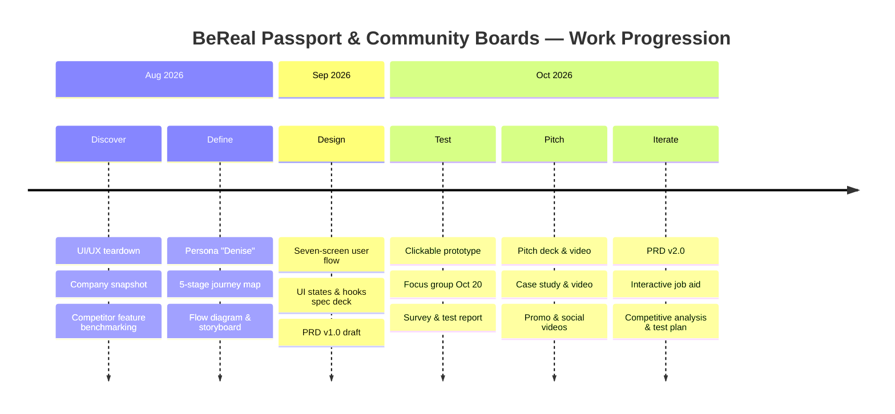

# BeReal Passport & Community Boards — Project Timeline

**[Live prototype](https://lashawnfofung.github.io/BeReal-RealProcess/)** · **[PRD v2.0](https://github.com/LashawnFofung/BeReal-RealProcess/blob/main/PRD/PRD.md)** · **[Test Plan](https://github.com/LashawnFofung/BeReal-RealProcess/blob/main/Test%20Plan/Test%20Plan.md)** · **[Back to README](https://github.com/LashawnFofung/BeReal-RealProcess#readme)**

> *Independent concept created for a UI/UX Design & Product Management Externship. Not affiliated with or endorsed by BeReal.*

---

## Summary

The project ran from **August to October 2026**, from a teardown of the current app to a tested, pitched and revised feature. The biggest turning point was the **October 20 focus group**: it validated the direction (**4 of 5** would open BeReal more often) and surfaced the main friction (**too many taps**), which reshaped the requirements, the rollout plan and the test plan that followed.

 

## Milestones

| When | Phase | Milestone | Artifact |
| --- | --- | --- | --- |
| Aug 2026 | 1. Discover | UI/UX teardown of the current app and a company snapshot | [Teardown (PDF)](https://github.com/LashawnFofung/BeReal-RealProcess/blob/main/BeReal_UIUX_Teardown.pdf) · [Snapshot](https://github.com/LashawnFofung/BeReal-RealProcess/blob/main/BeReal%20Corporate%20Snapshot.png) |
| Aug 2026 | 1. Discover | Benchmarked the retention features of TikTok and BeReal | [Competitive Analysis](https://github.com/LashawnFofung/BeReal-RealProcess/blob/main/Competitive%20Analysis/Competitive%20Analysis.md) |
| Aug 2026 | 2. Define | Persona "Denise" and 5-stage journey map; flow diagram and storyboard | [Persona & Journey](https://github.com/LashawnFofung/BeReal-RealProcess/blob/main/User%20Journey/Users.md) · [User Journey folder](https://github.com/LashawnFofung/BeReal-RealProcess/tree/main/User%20Journey) |
| Sep 2026 | 3. Design | Seven-screen user flow, UI states and re-engagement hooks in the spec deck | [Prototype folder](https://github.com/LashawnFofung/BeReal-RealProcess/tree/main/Prototype) |
| Sep 2026 | 3. Design | **PRD v1.0**: 1-pager and full requirements, drafted before testing | [PRD v1.0](https://github.com/LashawnFofung/BeReal-RealProcess/tree/main/PRD/PRD_v1) |
| Oct 2026 | 4. Prototype & test | Clickable prototype built from the spec deck with Claude | [Live prototype](https://lashawnfofung.github.io/BeReal-RealProcess/) · [Prompt engineering](https://github.com/LashawnFofung/BeReal-RealProcess/blob/main/Prototype/Prompt%20Engineering%20with%20Claude%20Opus%205.5%20Medium.md) |
| Oct 2026 | 4. Prototype & test | Focus group plan, discussion guide and 8-question survey | [Survey folder](https://github.com/LashawnFofung/BeReal-RealProcess/tree/main/Survey) |
| **Oct 20** | 4. Prototype & test | **Focus group**: 5 participants, 3 tasks, think-aloud plus survey | [Testing & Results](https://github.com/LashawnFofung/BeReal-RealProcess#testing--results) |
| Oct 21 | 4. Prototype & test | Repo created; prototype published on GitHub Pages | [Live prototype](https://lashawnfofung.github.io/BeReal-RealProcess/) |
| Oct 22 | 4. Prototype & test | Survey results, focus group notes and observer notes | [Survey results](https://github.com/LashawnFofung/BeReal-RealProcess/tree/main/Survey) |
| Oct 24 | 5. Pitch | Test summary report, pitch narrative and evidence pack | [Pitch folder](https://github.com/LashawnFofung/BeReal-RealProcess/tree/main/Pitch) |
| Oct 25 | 5. Pitch | **Pitch deck and 5-minute pitch video** | [▶️ Pitch video](https://youtu.be/Or5O1wUj_Ow) |
| Oct 25–26 | 5. Pitch | **Case study deck and 16-minute video**; promo reel and social cuts | [▶️ Case study](https://youtu.be/yxYclJn8ZGc) · [▶️ Promo reel](https://youtube.com/shorts/exXoJ6NqmbI) |
| **Oct 27** | 6. Revise requirements | **PRD v2.0**: test results added; rollout re-phased to "refine, then retest" | [PRD process & changes](https://github.com/LashawnFofung/BeReal-RealProcess/blob/main/PRD/PRD.md) |
| Oct 27 | 7. Enable users | Interactive job aid, step-list spreadsheet and reusable prompt | [Job aid](https://lashawnfofung.github.io/BeReal-RealProcess/Job%20Aid/BeReal_BeReal%20Passport%20and%20Community%20Boards_Interactive_Job_Aid.html) · [Process & prompt](https://github.com/LashawnFofung/BeReal-RealProcess/blob/main/Job%20Aid/Prompt%20Engineering.md) |
| Oct 27 | 8. Strategy | Competitive analysis, feature working session and A/B test plan | [Competitive Analysis](https://github.com/LashawnFofung/BeReal-RealProcess/blob/main/Competitive%20Analysis/Competitive%20Analysis.md) · [Working Session](https://github.com/LashawnFofung/BeReal-RealProcess/blob/main/Competitive%20Analysis/Feature%20Working%20Session.md) · [Test Plan](https://github.com/LashawnFofung/BeReal-RealProcess/blob/main/Test%20Plan/Test%20Plan.md) |

August and September milestones are shown by month. Dates from October 20 onward come from the case study and the repo's commit history.

 

## How the plan changed along the way

| Moment | What I learned | What changed |
| --- | --- | --- |
| **Benchmarking (Aug)** | Competitors win daily habits with pressure: endless feeds, public likes, loss-framed streaks | Set guardrails: authentic, opt-in, low pressure, friends-only |
| **Design (Sep)** | Taking the photo had to stay as fast as it is today | Put the board choice *after* the photo, as a layer on top |
| **Focus group (Oct 20)** | The risk wasn't pressure; it was **complexity** | Top fix became "cut taps from capture to stamp" |
| **PRD v2.0 (Oct 27)** | Five testers show direction, not proof | Rollout re-phased: refine and retest before building an MVP; A/B test plan added |

 

## Up next

These phases come from [PRD v2.0](https://github.com/LashawnFofung/BeReal-RealProcess/blob/main/PRD/PRD.md) and the [Test Plan](https://github.com/LashawnFofung/BeReal-RealProcess/blob/main/Test%20Plan/Test%20Plan.md). No dates are set yet.

| Phase | Plan | Exit criteria |
| --- | --- | --- |
| **1. Refine & retest** | Cut taps, clarify SEND vs. COMMUNITY BOARD, add a first-use explainer; retest with 7–10 people | ≤ 3 taps from shutter to stamp; ≥ 80% task success |
| **2. MVP + A/B test** | One board, full loop, squad-randomized experiment over 8 weeks | Active days +5% for casual users, no guardrail breached |
| **3. Full rollout** | Four themed boards a month, plus shorter observance boards | Sustained lift after the novelty wears off |
| **4. Sponsored pilot** | Sponsor-branded boards and stamps | Brand-safety review passed; no drop in trust |

---

Built by **Lashawn Fofung**, MBA, PMP, CSM, CSPO.
