# BeReal Passport & Community Boards — UI/UX Design

**[🎨 Canva prototype slides](https://canva.link/fmqg87m397xw54v)** · **[Prototype deck (PDF)](https://github.com/LashawnFofung/BeReal-RealProcess/blob/main/Prototype/BeReal%20Prototype%20-%20Real%20Passport%20And%20Community%20Boards.pdf)** · **[Live prototype](https://lashawnfofung.github.io/BeReal-RealProcess/)** · **[Back to README](https://github.com/LashawnFofung/BeReal-RealProcess#readme)**

> *Independent concept created for a UI/UX Design & Product Management Externship. Not affiliated with or endorsed by BeReal.*

---

## Summary

I designed every screen of BeReal Passport & Community Boards in **Canva** as a high-fidelity, slide-by-slide prototype: seven screens, four UI states and three re-engagement hooks, each annotated with what the user does and why. The Canva deck then became the spec for the [clickable HTML prototype](https://lashawnfofung.github.io/BeReal-RealProcess/).

The design goal in one line: **add a new reason to open BeReal without making it feel like a different app.** Every new element had to look and behave like it already belonged in BeReal.

 

## Design principles

I set five visual principles and a four-step flow before designing any screen, and wrote them on the concept slide so every later decision could be checked against them.

| Principle | What it means on screen |
| --- | --- |
| **Pitch-black canvas** | BeReal's near-black background everywhere; color is reserved for stamps and a single call to action |
| **Candid dual-camera feel** | The familiar back camera full frame, with the front camera as a small overlay; no filters, no retakes |
| **Tactile pastel stamp ink** | Each board gets a passport stamp with its own muted ink color, like a real travel stamp |
| **Private squad reactions** | Reactions stay inside the squad; there are no public like counts anywhere |
| **Monthly collection loop** | Boards close each month and become a capsule, a keepsake rather than an endless feed |

**The flow:** 01 Capture First → 02 Pick a Board → 03 Collect Stamps → 04 Archive Together

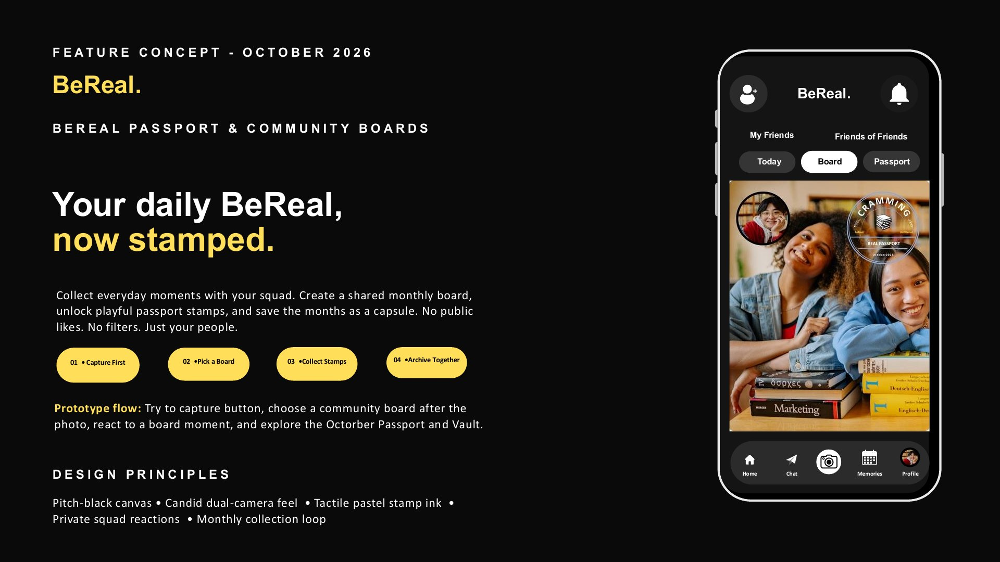

### UX principles behind the decisions

| Principle | Where it shows up |
| --- | --- |
| **Jakob's law** (users expect your app to work like the ones they know) | Top bar, Friends tabs and bottom navigation are kept exactly as in BeReal; the feature lives *inside* familiar patterns |
| **Hick's law** (fewer choices, faster decisions) | After the photo there are only two choices: **SEND** or **COMMUNITY BOARD** |
| **Visibility of system status** | Every post shows loading, success or error, plus an empty state |
| **Feedback** | Picking a board turns its card from grey to white and its lock icon to unlocked |
| **Recognition over recall** | Each board shows its stamp, name, lock state and post count, so nothing has to be remembered |
| **Progressive disclosure** | A one-time intro for new users; returning users go straight to the board snapshot |
| **Error prevention** | Boards are opt-in only; nobody is auto-enrolled |
| **Gestalt grouping** | Boards sit in a uniform 3-column card grid; related settings sit together under Features |
| **Emotional design** | Copy invites rather than pressures: "No one's posted to this board yet — be the first!" |

 

## Design system

| Token | Value | Used for |
| --- | --- | --- |
| **Canvas** | `#0A0A0A` (near-black) | Every screen background |
| **Surface** | `#2C2C2C` (dark grey) | Cards, rows, unselected board tiles and pills |
| **Text** | `#FFFFFF` | Wordmark, headings and labels |
| **Muted text** | Grey | Helper copy, timestamps, "Friends of Friends" |
| **Accent** | `#FFDE59` (yellow) | One call to action per screen (e.g. "View October Capsule Carousel") and the slide annotations |
| **Selected state** | `#FFFFFF` fill, black text | Active tab ("Today", "Board", "Passport") and the chosen board |
| **Stamp inks** | Cramming `#99AACB` · Hike `#16A463` · Coffee `#C39879` · Haunted `#B8672B` · Game Time `#EDD869` · Little Wins `#99A9C9` | One ink color per board |

**Typography:** a bold sans serif for the "BeReal." wordmark, screen titles and buttons; a regular sans serif for helper text, kept small and grey so it never competes with the photo. The slide annotations use wide letter-spacing in all caps ("FEATURE CONCEPT - OCTOBER 2026").

**Shapes:** rounded rectangles for phones, cards and rows; fully rounded pills for tabs and buttons; circles for the shutter, avatars and stamps.

**Accessibility check:** white on the canvas is a 19.8 : 1 contrast ratio, yellow on the canvas 14.9 : 1, and white on the grey surface 14.0 : 1. All of these pass WCAG AA and AAA for normal text. Color is never the only signal: a selected board also changes its label and lock icon.

 

## Building the prototype in Canva

Each screen was built as a phone mockup on a dark slide: a rounded-rectangle device frame, the screen content layered inside, and annotations on the left explaining the user's action and the reasoning. Arrows connect each "before" screen to its "after" screen, so a reviewer can follow the flow without clicking.

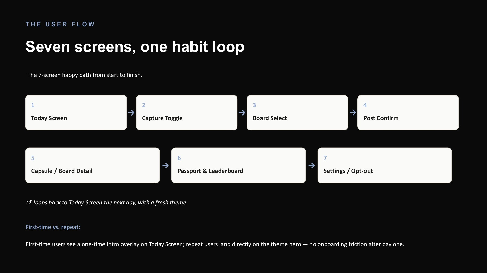

**Reusable building blocks**, duplicated across every screen so they stay identical:

| Component | Built from | Why it's reusable |
| --- | --- | --- |
| **Top bar** | Add-friend icon · "BeReal." wordmark · bell icon with a red count badge | Anchors every screen as BeReal |
| **Friends tabs** | Two text labels: "My Friends" · "Friends of Friends" | Mirrors BeReal's existing feed switcher |
| **Feature tabs** | Three pills: **Today · Board · Passport**, with the active one filled white | The single entry point to the whole feature |
| **Bottom navigation** | Home · Chat · camera shutter (circle) · Memories · Profile | Unchanged from BeReal, so the feature never feels separate |
| **Board tile** | Grey rounded card · stamp image · lock icon · friend avatars · post count | One tile works for the grid, select and snapshot screens |
| **Passport stamp** | Circular badge: board name in curved text, an illustration, "REAL PASSPORT", "BeReal." and "Unfiltered" labels, the month | The collectible at the heart of the feature |
| **Pop-up modal** | Grey rounded card over a blurred screen, with an icon and a message | Used for the intro, loading, success, error and reminders |

 

## Screen by screen

### 1. Today screen (new user)

**Goal:** tell users the month's boards are open and invite them to join, without pressure.

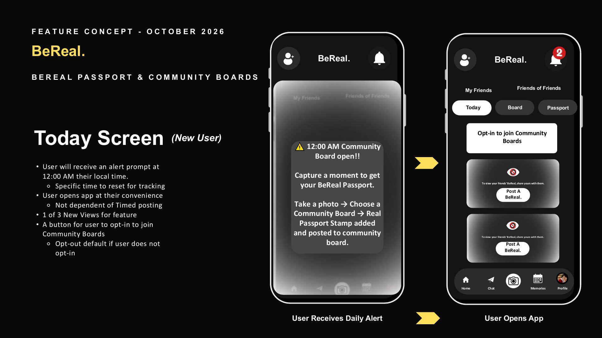

| Element | Design decision |
| --- | --- |
| **12:00 AM alert** | A pop-up in BeReal's familiar warning style: "⚠️ 12:00 AM Community Board open!!" It's a fixed daily reset, not a timed post, so users open the app whenever it suits them. |
| **How-it-works line** | "Take a photo → Choose a Community Board → Real Passport Stamp added", the whole feature in one sentence |
| **Opt-in button** | A white card at the top of the feed: "Opt-in to join Community Boards." It's the only bright element, so it's the obvious next step |
| **Locked feed** | Friends' posts stay blurred, with an eye-off icon and "To view your friends' BeReal, share yours with them," reusing BeReal's own reciprocity rule and copy |

### 2. Capture toggle

**Goal:** keep capture exactly as fast as today, then offer the board as a choice.

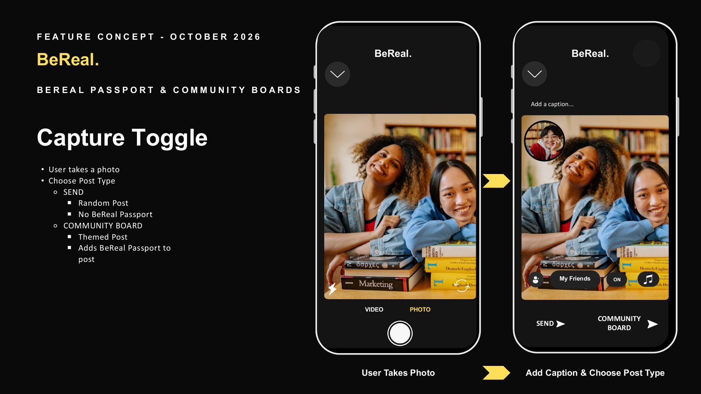

| Element | Design decision |
| --- | --- |
| **Camera screen** | Unchanged: back camera full frame, front camera overlay at top left, VIDEO / PHOTO labels and the circular shutter |
| **Post-type choice** | Two buttons at the bottom: **SEND** (random post, no stamp) and **COMMUNITY BOARD** (themed post that adds a stamp). Two options only (Hick's law) |
| **Community Board toggle** | A small "ON" switch next to "My Friends" shows which audience the post goes to |
| **Caption field** | "Add a caption…" stays at the top, as in BeReal |

**Key decision:** the board choice comes *after* the photo. Testers later noticed this adds a step, which became the top fix in the [Test Plan](https://github.com/LashawnFofung/BeReal-RealProcess/blob/main/Test%20Plan/Test%20Plan.md).

### 3. Board select

**Goal:** make choosing a board feel instant and unmistakable.

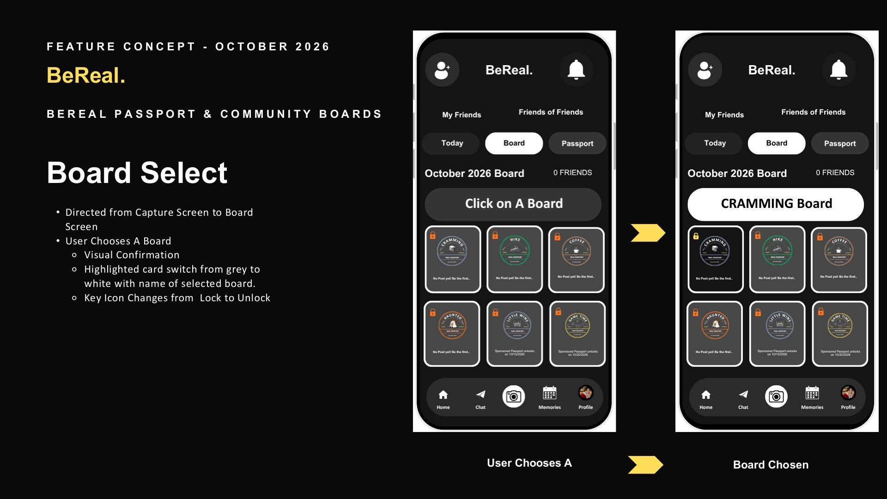

| Element | Design decision |
| --- | --- |
| **Header** | "October 2026 Board" with a friend count, so users know which month they're in |
| **Prompt bar** | "Click on a Board" changes to the board's name ("CRAMMING Board") once chosen |
| **Board grid** | Six tiles in a 3 × 2 grid: four themed boards (Hike, Cramming, Coffee, Haunted) and two sponsored ones (Little Wins, Game Time) |
| **Selected state** | The chosen tile turns from grey to white and its lock changes to unlocked: two signals, not just color |

### 4. Post confirm (UI states)

**Goal:** never leave the user wondering what happened.

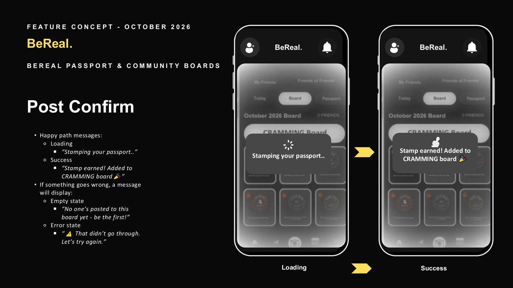

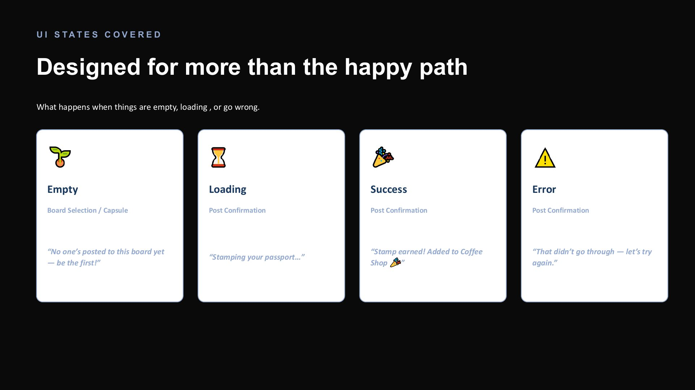

| State | Message | Design decision |
| --- | --- | --- |
| **Loading** | "Stamping your passport.." | A spinner in the modal; the copy turns waiting into anticipation |
| **Success** | "Stamp earned! Added to CRAMMING board 🎉" | The stamp image appears, a reward moment, with "See it on the board" and "Open my Passport" buttons |
| **Error** | "⚠️ That didn't go through. Let's try again." | Calm, blame-free copy; the photo is kept so nothing is lost |
| **Empty** | "No one's posted to this board yet — be the first!" | Turns a dead end into an invitation |

### 5. Board feed

**Goal:** show the post landing among the squad's posts.

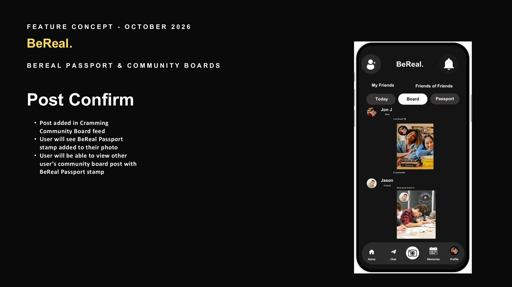

The user's post appears in the CRAMMING board feed with the **passport stamp in the corner** of the photo, the same placement as a real passport stamp. Friends' stamped posts sit below it. Reactions are emoji-based and visible only to the squad.

### 6. Today screen (returning user)

**Goal:** give returning users a reason to come back every day.

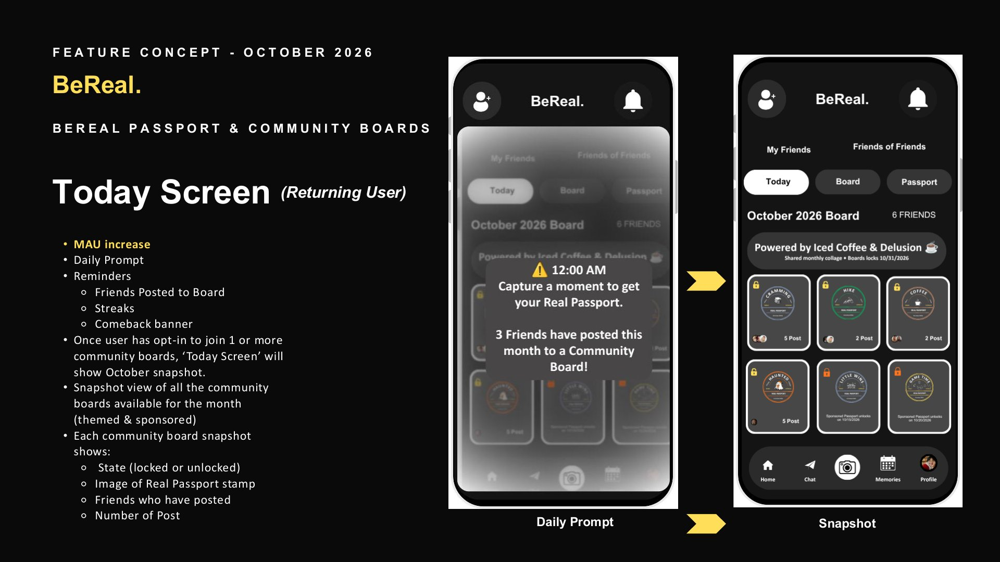

| Element | Design decision |
| --- | --- |
| **Daily prompt** | A pop-up: "3 Friends have posted this month to a Community Board!" Social curiosity, not an alarm |
| **Sponsor line** | "Powered by Iced Coffee & Delusion ☕️ · Board locks 10/31/2026", showing how sponsorship could appear without ads in the feed |
| **Board snapshot** | Every board at a glance: lock state, stamp, friends who've posted, number of posts |

### 7. Reminders (re-engagement hooks)

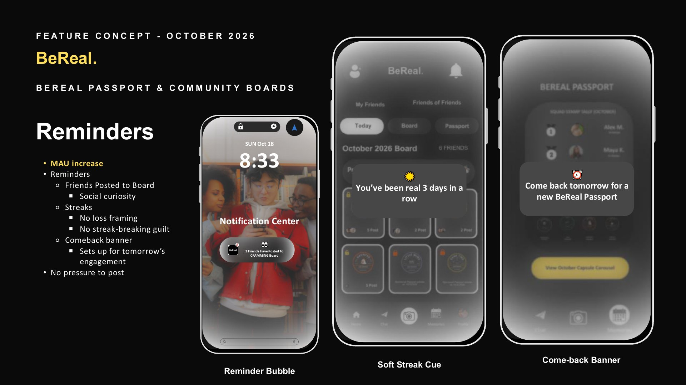

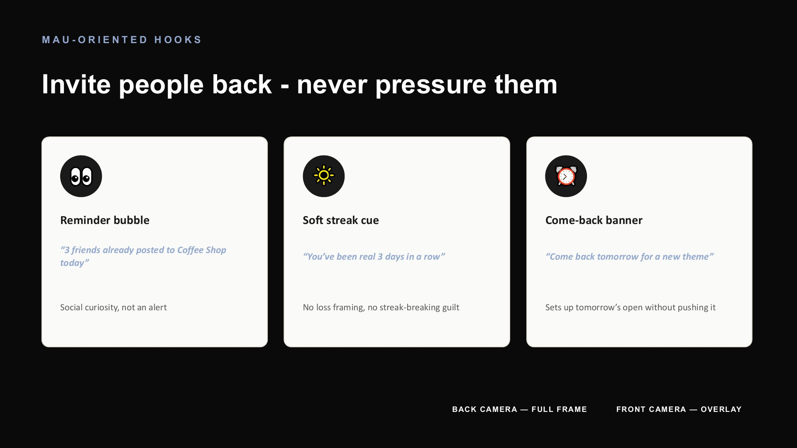

| Hook | Copy | Design decision |
| --- | --- | --- |
| **Reminder bubble** | "3 friends already posted to CRAMMING today 👀" | Lands in the notification center; curiosity, not an alert |
| **Soft streak cue** | "You've been real 3 days in a row ☀️" | No loss framing and no streak to break |
| **Come-back banner** | "Come back tomorrow for a new BeReal Passport ⏰" | Sets up tomorrow's open without pushing it |

### 8. Capsule / board details

**Goal:** turn each month into a keepsake.

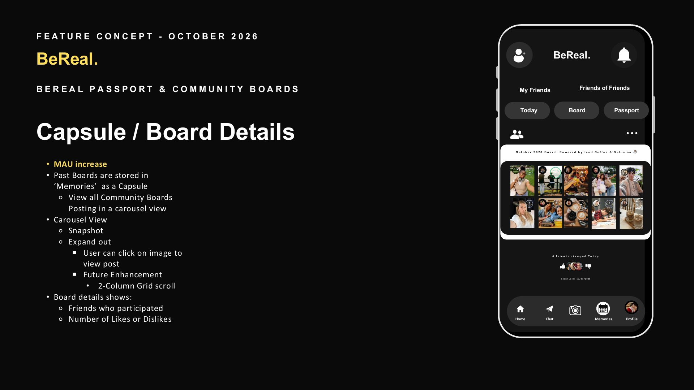

Past boards live in **Memories** as a capsule: a collage of the month's posts that opens into a carousel. Board details show who took part and the 👍 / 👎 totals. A two-column grid scroll is noted on the slide as a future enhancement.

### 9. BeReal Passport

**Goal:** make collecting feel tactile and worth coming back for.

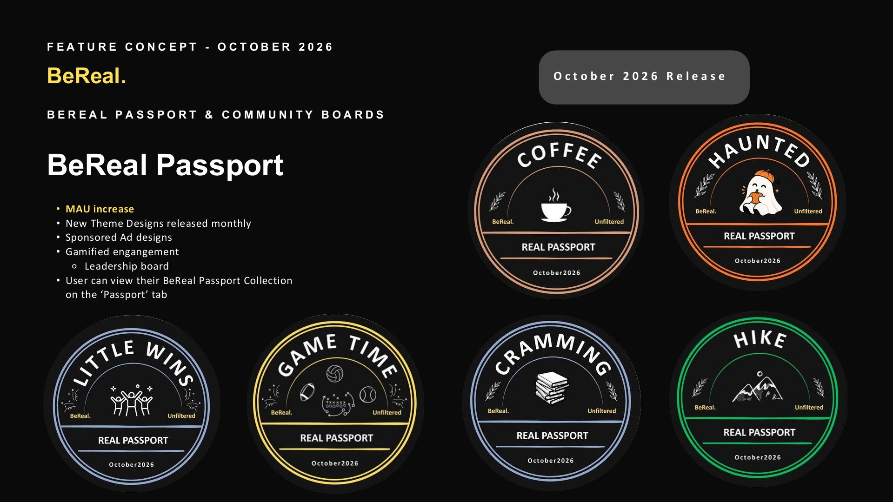

Six stamps designed as **vintage passport badges**. Each one shares the same structure (curved board name, illustration, "REAL PASSPORT", "BeReal." and "Unfiltered" labels and the month), and each has its own ink color and illustration:

| Stamp | Illustration | Ink |
| --- | --- | --- |
| Coffee | Steaming cup | Warm tan |
| Haunted | Ghost | Burnt orange |
| Cramming | Stack of books | Slate blue |
| Hike | Mountains | Green |
| Game Time | Sports balls | Gold |
| Little Wins | Celebrating friends | Soft blue |

An "October 2026 Release" label signals that new designs arrive every month, including sponsored ones.

### 10. Leaderboard (Squad Stamp Tally)

**Goal:** add light, friendly competition inside the squad only.

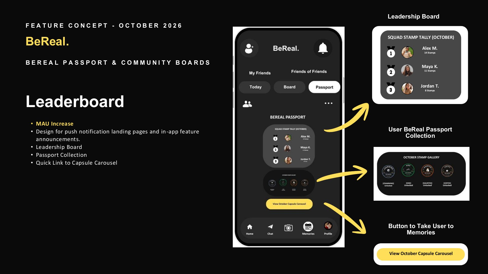

The Passport tab stacks three parts: the **Squad Stamp Tally** (ranked avatars with medal numbers and stamp counts), the **October stamp gallery** (earned stamps marked "Unlocked"), and a yellow **"View October Capsule Carousel"** button, the screen's one accent-colored call to action.

### 11. Settings / opt-out

**Goal:** keep users in control at all times.

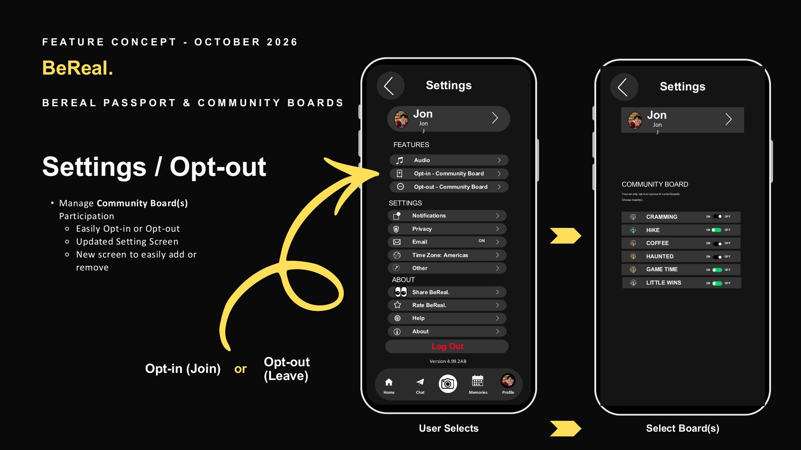

| Element | Design decision |
| --- | --- |
| **Features section** | New rows, "Opt-in - Community Board" and "Opt-out - Community Board", sit with BeReal's existing settings rows, using the same row style |
| **Board list** | Each current board has its own stamp icon, name and ON / OFF switch |
| **Helper text** | "You can only opt-in or opt-out of current boards," which sets expectations up front |

 

## Staying true to the BeReal brand

| BeReal brand trait | How the design keeps it |
| --- | --- |
| **Authenticity** | The photo is the same real, unfiltered dual-camera BeReal; the stamp is a layer on top, never a filter or edit |
| **Minimal, dark interface** | Same black canvas, white wordmark and sparse chrome; only stamps and one CTA per screen add color |
| **"BeReal." wordmark** | Kept on every screen, and printed on every stamp alongside "Unfiltered" |
| **Familiar navigation** | Top bar, Friends tabs and bottom navigation unchanged; the feature adds one row of tabs (Today · Board · Passport) |
| **Reciprocity** | The locked feed stays: post to see your friends' posts |
| **Candid, playful voice** | Copy like "Stamping your passport..", "be the first!" and "Powered by Iced Coffee & Delusion" matches BeReal's casual tone |
| **No vanity metrics** | No public likes or follower counts; reactions and the tally stay inside the squad |
| **Low pressure** | No countdown timers on boards, no streak loss and fully opt-in |

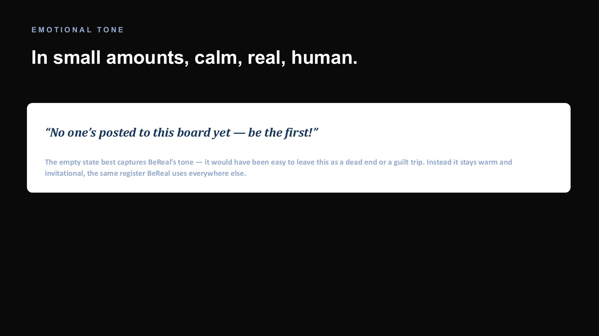

**What I deliberately didn't add:** an algorithmic feed, public leaderboards, loss-framed streaks or filters. Each would have increased engagement on paper while breaking what makes BeReal *BeReal*. The reasoning is in the [Feature Working Session](https://github.com/LashawnFofung/BeReal-RealProcess/blob/main/Feature%20Working%20Session/Feature%20Working%20Session.md).

 

## From Canva to a clickable prototype

| Step | What happened |
| --- | --- |
| **1. Canva deck** | Every screen, state and hook designed and annotated, slide by slide |
| **2. Spec handoff** | The deck became the specification for a clickable HTML prototype built with Claude, including the UI states and a demo panel for first-time vs. returning users ([prompt engineering](https://github.com/LashawnFofung/BeReal-RealProcess/blob/main/Prototype/Prompt%20Engineering%20with%20Claude%20Opus%205.5%20Medium.md)) |
| **3. User testing** | 5 testers used the clickable prototype: 4 of 5 would open BeReal more often, and the main friction was the number of taps |
| **4. Refinement** | In the case study and PRD v2.0, the opt-in wording was corrected to "opt-in only" and the Settings icons were refined to standard back arrows and chevrons |
| **5. Job aid** | Real prototype screens captured into an [interactive job aid](https://lashawnfofung.github.io/BeReal-RealProcess/Job%20Aid/BeReal_BeReal%20Passport%20and%20Community%20Boards_Interactive_Job_Aid.html) |

 

## What I'd refine next

- **Fewer taps from shutter to stamp:** for example, remember the last board used, or show board chips right on the post-type screen.
- **Clearer SEND vs. COMMUNITY BOARD labels** with a one-line explainer on first use.
- **A first-use walkthrough** for new users, tested with non-users.

---

Built by **Lashawn Fofung**, MBA, PMP, CSM, CSPO.
